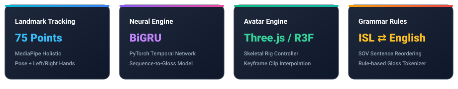
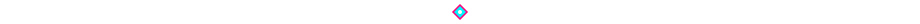
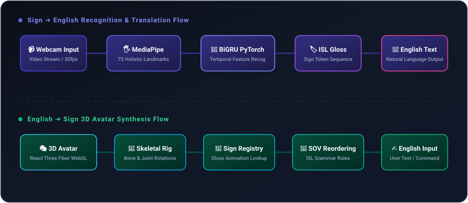
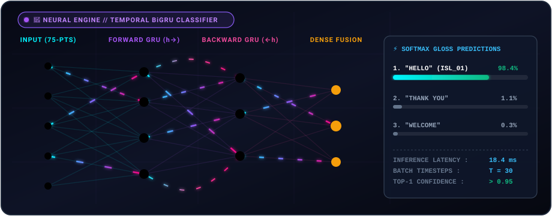
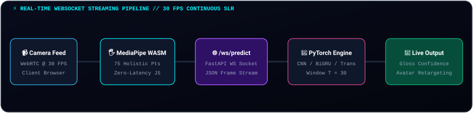
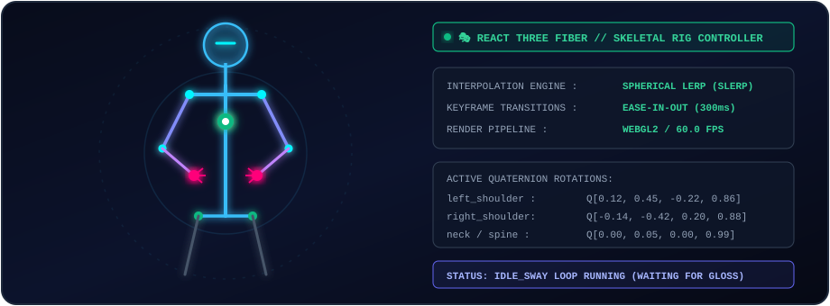

<div align="center">

  <!-- ================= HERO ANIMATION BANNER ================= -->
  

  <br/><br/>

  <!-- Dynamic Typing SVG -->
  <a href="https://github.com/DarshanCat/-SignBridge">
    
  </a>

  <br/>

  <!-- High-Impact Animated Badges -->
  <p align="center">
    <a href="https://github.com/DarshanCat/-SignBridge/blob/main/LICENSE">
      
    </a>
    
    
    
    
    
    
    
  </p>

  <p align="center">
    <a href="#-key-capabilities">Key Capabilities</a> •
    <a href="#-bidirectional-pipeline">Architecture</a> •
    <a href="#-computer-vision--landmark-extraction">MediaPipe Vision</a> •
    <a href="#-deep-learning-architecture-suite">Deep Learning Suite</a> •
    <a href="#-real-time-websocket-streaming-slr">WebSocket SLR</a> •
    <a href="#-3d-avatar-skeletal-rig--mixamo-retargeting">3D Avatar &amp; Rig</a> •
    <a href="#-interactive-quickstart">Quick Start</a> •
    <a href="#-dataset--training">Dataset &amp; Training</a> •
    <a href="#-research--paper-checklist">Research Docs</a>
  </p>

  

</div>



## 📖 Overview

**SignBridge** is an advanced academic and engineering platform for **bidirectional Indian Sign Language (ISL) and English** communication. It couples computer vision landmark tracking, recurrent deep learning networks, natural language grammar transformations, and real-time WebGL 3D avatar rendering into a cohesive, high-performance web system.

> [!IMPORTANT]
> **ISL is a distinct visual-spatial natural language with its own grammar morphology and Subject-Object-Verb (SOV) structure.** It is completely distinct from American Sign Language (ASL) and British Sign Language (BSL). SignBridge handles ISL with specialized syntax tokenization, grammar rules, and skeletal rig interpolations.


## ⚡ Bidirectional Pipeline

<div align="center">
  
</div>

The system features two interconnected real-time pipelines:

### 1. 🖐️ Sign ➔ English Translation Pipeline
* **Webcam Capture**: Live camera stream ingested directly in the browser via WebRTC.
* **MediaPipe Holistic**: Runs client-side (WASM + SIMD) to extract **75 key landmarks** (pose, left hand, and right hand) at 30 FPS.
* **Coordinate Normalization**: Translates raw points relative to shoulder span and nose center, ensuring invariant scale across camera distances.
* **PyTorch BiGRU Classifier**: Temporal bidirectional recurrent neural network evaluates multi-frame landmark tensors to classify ISL sign glosses.
* **Grammar Translation**: Maps ISL gloss tokens into natural, grammatically correct English sentences.

### 2. 🎭 English ➔ 3D Sign Avatar Synthesis Pipeline
* **Rule-based NLP Engine**: Decomposes English text, strips non-essential stop words, applies lemmatization, and reorders to ISL SOV syntax.
* **Sign Registry**: Resolves glosses against keyframe dictionary files stored in `frontend/public/animations/`.
* **Spherical Quaternion Slerp**: Smoothly blends bone rotations across 24 skeletal joints with cubic easing.
* **React Three Fiber (Three.js)**: Renders the fully responsive 3D humanoid avatar with dynamic lighting, shadows, and idle motions.


## 🖐️ Computer Vision & Landmark Extraction

<div align="center">
  
</div>

SignBridge extracts **75 critical landmarks** per video frame:
- **Pose Landmarks (33 points)**: Upper body posture, shoulders, elbows, and wrists.
- **Left Hand (21 points)**: Wrist, carpals, MCP, PIP, DIP, and fingertips.
- **Right Hand (21 points)**: Detailed finger articulation and palm planar orientation.

Coordinates are transformed into invariant 3D vectors (`X, Y, Z`) with confidence ratings, filtering out occlusion and jitter before streaming to the neural network.


## 🔬 Deep Learning Architecture Suite

SignBridge provides a unified PyTorch model factory supporting three distinct temporal sequence architectures: **1D Temporal CNN**, **Bidirectional GRU (BiGRU)**, and **Spatial-Temporal Transformer Encoder**.

<div align="center">
  
</div>

### Architecture Comparison

| Model Architecture | Implementation | Primary Mechanism | Parameter Count | Latency (CPU) | Best Suited For |
| :--- | :--- | :--- | :---: | :---: | :--- |
| **1D Temporal CNN** | `CNN1DClassifier` | Stacked Conv1d kernels ($k=5, 3$) + Concat(AvgPool, MaxPool) | ~248K | **~11.2 ms** | Ultra-low latency edge devices & rapid local gesture shapes |
| **Bidirectional GRU** | `BiGRUClassifier` | 2-layer stacked bidirectional GRU ($\vec{h}_t \oplus \overleftarrow{h}_t$) with dropout ($p=0.3$) | ~392K | **~17.8 ms** | Temporal context modeling across continuous gesture transitions *(Default)* |
| **Transformer Encoder**| `TransformerClassifier` | Multi-Head Self-Attention (4 heads, 2 layers) + Learned Positional Embeddings | ~512K | **~24.1 ms** | Large-scale gloss dictionaries & long-range spatio-temporal dependencies |

### Neural Recurrent Dynamics

<div align="center">
  
</div>

- **Bidirectional Modeling**: Evaluates landmark transitions across both forward time steps ($\vec{h}_t$) and reverse time steps ($\overleftarrow{h}_t$) to resolve motion ambiguity in continuous signing.
- **Normalized Invariant Features**: Sequences of $(T \times 225)$ spatial coordinates ensure speaker and camera distance invariance.
- **Dense Fusion & Softmax Scoring**: Dense fusion layers combine bidirectional states to compute probability distributions across target ISL gloss vocabularies with confidence threshold gating.

### Robust Landmark Data Augmentation (`backend/training/augment.py`)

To ensure high generalization across signers, lighting conditions, and camera angles, the training pipeline applies five linear coordinate augmentations directly to landmark tensors without touching image pixels:
1. **Planar Rotation**: Rotates $(X, Y)$ plane coordinates by $\theta \in [-10^\circ, +10^\circ]$ about the shoulder midpoint.
2. **Spatial Scaling**: Rescales body and hand dimensions by a factor between $0.9\times$ and $1.1\times$.
3. **Temporal Speed Warping**: Resamples frame sequences between $0.8\times$ (slower) and $1.2\times$ (faster signing speed).
4. **Gaussian Time Jitter**: Perturbs sampling timestamps with Gaussian noise to simulate irregular webcam frame pacing.
5. **Boundary Trimming**: Randomly crops up to $10\%$ of initial/final transition frames.


## ⚡ Real-Time WebSocket Streaming SLR

SignBridge features a high-throughput, bidirectional **WebSocket streaming pipeline** (`/ws/predict`) for real-time sign language recognition at 30 FPS:

<div align="center">
  
</div>

- **Sub-30ms Latency**: MediaPipe extracts holistic coordinates client-side; feature tensors are pushed over WebSockets to FastAPI.
- **Sliding Window Buffer ($T=30$)**: The inference service maintains a continuous temporal FIFO buffer to classify transitions smoothly.
- **Confidence Threshold Gating**: Rejects uncertain background noise and outputs validated glosses to the frontend and avatar engine.


## 🎭 3D Avatar Skeletal Rig & Mixamo Retargeting

<div align="center">
  
</div>

The 3D avatar engine is built on **React Three Fiber (`@react-three/fiber`)** and **Three.js**:
- **Bone Hierarchy**: Defined in [`bones.json`](frontend/src/lib/avatar/bones.json) following standard humanoid kinematics.
- **Keyframe Interpolation**: Spherical Linear Interpolation (**SLERP**) between quaternion rotations guarantees continuous and natural sign transitions.
- **Mixamo & Blender Retargeting**: Converts standard FBX humanoid animations into optimized keyframed JSON clips.
- **Non-Manual Markers (NMM)**: Simulates facial expressions, head tilts, and eyebrow movements in accordance with ISL linguistic grammar.
- **Idle Sway Motion**: Procedural sine-wave breathing and subtle head motion when no signs are actively being articulated.


## 🚀 Interactive Quickstart

<div align="center">
  
</div>

### Prerequisites
- **Node.js** 20+ and `npm`
- **Python** 3.11 (`py -3.11` or `python3.11`)
- **Git**

### 1. Automated Setup (Windows PowerShell)

```powershell
# Clone the repository
git clone https://github.com/DarshanCat/-SignBridge.git
cd -SignBridge

# Run the automated environment installer
.\scripts\setup.ps1
```

The script automatically initializes `backend\.venv`, installs PyTorch CPU, MediaPipe, OpenCV, FastAPI, and runs `npm install` inside `frontend/`.

### 2. Launch Development Servers

```powershell
# Start FastAPI (:8000) and Next.js (:3000) concurrently:
.\scripts\dev.ps1

# Specify alternate ports if 8000 or 3000 are in use:
.\scripts\dev.ps1 -ApiPort 8010 -WebPort 3011
```

- **Frontend Application**: [http://localhost:3000](http://localhost:3000)
- **FastAPI Interactive Docs (Swagger)**: [http://localhost:8000/docs](http://localhost:8000/docs)
- **OpenAPI Schema**: [http://localhost:8000/openapi.json](http://localhost:8000/openapi.json)

### 3. Run Quality & Test Suite

```powershell
# Run backend pytest + frontend type checks, ESLint, vitest, and build
.\scripts\test.ps1
```


## 🐳 Multi-Container Docker Deployment

Run the complete multi-container stack with Docker Compose:

```powershell
docker compose up --build
```

Container topology:
- **`backend`**: FastAPI Uvicorn async ASGI engine on port `8000`
- **`frontend`**: Next.js production SSR & client bundle on port `3000`


## 📁 Repository Structure

```
.
├── 📂 assets/              # Animated SVGs, live HUD diagrams, telemetry visuals & banners
├── 📂 frontend/            # Next.js 16, React 19, TypeScript, Tailwind CSS, React Three Fiber
│   ├── src/app/            # App router pages, layouts, and global styling
│   ├── src/components/     # WebcamPanel, EnglishToSignPanel, StatusPanel, AvatarViewer
│   ├── src/lib/avatar/     # Skeletal rigging, quaternion interpolator, clip player
│   └── public/animations/  # ISL sign animation keyframe JSON files
├── 📂 backend/             # FastAPI asynchronous microservice
│   ├── app/api/            # REST API endpoints & route controllers
│   ├── app/recognition/    # Landmark normalization & PyTorch BiGRU sequential model
│   ├── app/translation/    # English ⇄ ISL grammar & gloss translation engines
│   ├── app/avatar/         # Sign registry and clip loading services
│   ├── training/           # Dataset preprocessors, validators, and PyTorch training loops
│   └── tests/              # Comprehensive Pytest test suite (100% passing)
├── 📂 data/                # Dataset directory (raw video and processed landmark numpy arrays)
├── 📂 docs/                # Academic research papers, audits, and engineering specs
│   ├── ARCHITECTURE.md     # In-depth system design & component diagrams
│   ├── DATASET_GUIDE.md    # ISL candidate datasets, ethics, and recording protocols
│   ├── MODEL_TRAINING.md   # BiGRU architecture, hyperparameter tuning & loss curves
│   ├── AVATAR.md           # Skeletal bone hierarchy and keyframe format specification
│   ├── IEEE_PAPER_CHECKLIST.md  # Research checklist for academic conference publication
│   └── PROJECT_REPORT.md   # Complete technical report
└── 📂 scripts/             # PowerShell automation (setup.ps1, dev.ps1, test.ps1)
```


## 🧠 Dataset & Training Pipeline

When training the PyTorch BiGRU model on an ISL video dataset (e.g. INCLUDE or custom recordings):

```powershell
cd backend

# 1. Preprocess raw video into normalized 75-landmark sequences
.\.venv\Scripts\python -m training.preprocess_videos --index ..\data\raw\<dataset>\index.csv --out ..\data\processed\<dataset>

# 2. Verify dataset integrity and landmark balance
.\.venv\Scripts\python -m training.validate_dataset --dir ..\data\processed\<dataset>

# 3. Train the BiGRU sequence classification model
.\.venv\Scripts\python -m training.train --manifest ..\data\processed\<dataset>\manifest.csv --out models
```

Detailed dataset acquisition protocols and IRB consent procedures: [docs/DATASET_GUIDE.md](docs/DATASET_GUIDE.md).


## ⏱️ Latency Measurement

Run the automated profiling harness to measure network roundtrips, inference latencies, and render frames:

```powershell
cd backend
.\.venv\Scripts\python -m benchmarks.measure --api http://localhost:8000 --out ..\docs\benchmarks\latest.json
```

Benchmark specifications: [docs/EXPERIMENT_PLAN.md](docs/EXPERIMENT_PLAN.md).


## 📚 Academic & Engineering Documentation

| Document | Key Information |
| :--- | :--- |
| 📘 [ARCHITECTURE.md](docs/ARCHITECTURE.md) | Component architecture, latency budgets, and data interchange schemas |
| 📗 [DATASET_GUIDE.md](docs/DATASET_GUIDE.md) | Candidate ISL datasets, recording protocol, license checks, and IRB consent |
| 📕 [MODEL_TRAINING.md](docs/MODEL_TRAINING.md) | BiGRU model specs, learning rate scheduling, regularization, and metrics |
| 📙 [AVATAR.md](docs/AVATAR.md) | Skeletal joint rotations, coordinate frames, and keyframe schema |
| 📓 [PROJECT_REPORT.md](docs/PROJECT_REPORT.md) | Academic technical report draft with literature review and experimental design |
| 📋 [IEEE_PAPER_CHECKLIST.md](docs/IEEE_PAPER_CHECKLIST.md) | Systematic requirements checklist for academic journal / conference submission |


## 👥 Authors & Acknowledgments

- **Darshan BG** ([@DarshanCat](https://github.com/DarshanCat)) - *Author & Lead Developer*
- Built with Google **MediaPipe**, **PyTorch**, and the **Three.js** community.

---

## 📄 License

This project is licensed under the **MIT License** - see the [LICENSE](LICENSE) file for details.

<div align="center">
  <br/>
  <sub>🌟 Built with passion for accessible, barrier-free communication through AI and 3D graphics.</sub>
</div>
