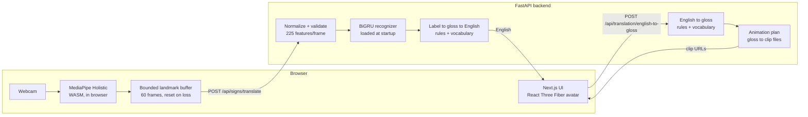

# SignBridge: Bidirectional Indian Sign Language Translation with a 3D Avatar

**Project report (working draft).** Authors: `[AUTHOR NAMES]`. Institution: `[INSTITUTION]`. Supervisor: `[SUPERVISOR]`.
Date: `[DATE]`. Target venue and template: `[NOT YET SELECTED]`.

Labels used throughout: **[Implemented]** exists in the repository; **[Tested]** covered by automated tests that were run;
**[Manually verified]** observed in a browser or terminal; **[Planned]** not built; **[Blocked]** needs an external resource.
Every statement of what the system *does* traces to a file in the repository. Nothing here is a measured research result
unless it is in Section 11.

## 1. Abstract

SignBridge is a web prototype that explores two directions of Indian Sign Language (ISL) translation: recognizing an
isolated sign from webcam landmarks and rendering English text as a sequence of sign animations on a 3D avatar. The software
foundation is implemented: in-browser MediaPipe Holistic landmark extraction, a 225-feature normalization pipeline, a
BiGRU sequence classifier with a reproducible signer-independent training pipeline, a configurable rule-based
English-to-gloss and gloss-to-English baseline, a clip-driven procedural avatar with sequential playback, and a FastAPI
backend. **At the time of writing no ISL dataset has been downloaded, no recognition model has been trained, and no
sign-specific animation clip has been authored or reviewed by an ISL signer.** Results are therefore pending
(Section 11). The system is a software foundation, not a validated ISL translator.

## 2. Introduction and problem statement

Deaf and hard-of-hearing people in India use ISL, a language distinct from English and from American Sign Language (ASL).
Automatic translation tools for ISL lag behind those for ASL; the CISLR authors state that ISL "is still far from"
data-driven tasks such as machine translation and that ASL has received much more attention (reference [5]). This project
builds an end-to-end prototype to study the engineering pipeline for ISL, with emphasis on honest reporting of what is
and is not working.

## 3. Objectives and scope

In scope: (1) webcam-based recognition of isolated ISL signs from landmarks; (2) mapping recognized labels to gloss
tokens and then to English; (3) mapping English text to a gloss sequence with an explicit, editable rule set;
(4) playing sign animation clips on a 3D avatar; (5) a reproducible training and evaluation procedure.

Out of scope or not claimed: continuous signing and sentence-level recognition; ISL grammar including facial and
non-manual markers; fingerspelling; complete natural-language translation; any ASL data used as ISL.

## 4. Related work

Only sources verified for this report are listed in Section 15. ISL resources: INCLUDE, a word-level ISL video dataset
[3]; ISL-CSLTR, a sentence-level corpus on Mendeley Data [4]; CISLR, a word-level corpus that also proposes a one-shot
baseline using ASL data [5]. A systematic literature review of ISL, ASL recognition and avatar-based generation has **not**
been performed; this section must be written from sources the authors have read before submission `[TODO]`.

## 5. System architecture

Source: `docs/ARCHITECTURE.md`, `backend/app/api/routes.py`. **[Implemented]** The model box is unpopulated until a
checkpoint exists.

## 6. Technology stack **[Implemented]**

Frontend: Next.js 14.2.18, React 18.3.1, TypeScript 5.6, Tailwind 3.4, three 0.169, React Three Fiber 8.17, Drei 9.114,
Vitest 2. Backend: Python 3.11.9, FastAPI 0.115.6, Pydantic 2.10.3, NumPy 2.1.3, PyTorch 2.5.1 (CPU), MediaPipe 0.10.14,
OpenCV 4.10, Pytest 8.3. Versions are pinned in `frontend/package.json`, `backend/requirements*.txt` and
`docs/PROJECT_STATUS.md`.

## 7. Dataset selection and preprocessing

Candidates and their licenses and caveats are recorded in `docs/DATASET_GUIDE.md`. **[Blocked]** No dataset has been
downloaded. INCLUDE's Zenodo record states CC BY 4.0, while a derived third-party record states CC BY-NC-SA 4.0; this
conflict must be resolved before use. Preprocessing tools **[Implemented, Tested on synthetic data only]**:
`training/preprocess_videos.py` (video to features), `training/validate_dataset.py`, `training/dataset_info.py` (rejects
non-ISL language tags), `training/record_sample.py` (consent-gated recording).

## 8. Landmark extraction **[Implemented; real camera Not verified]**

MediaPipe Holistic [1] runs in the browser (model complexity 0, smoothing on) using self-hosted files; Python MediaPipe
(same version family) is used for offline dataset preprocessing. Per frame: 33 pose, 21 left-hand, 21 right-hand
landmarks (x, y, z). Normalization translates to the shoulder midpoint and divides by 2D shoulder width. Missing hands
become zeros; frames without pose are invalid. Details: `docs/EXPERIMENT_PLAN.md` section 2. Verified: backend unit tests,
and in a browser the library loads and initializes; extraction from a live person has **not** been observed.

## 9. Recognition model design **[Implemented, Tested with synthetic data]**

A bidirectional GRU (gated recurrent unit family, introduced in [2]) with default 2 layers and 128 hidden units, mean
pooling over time, dropout 0.3 and a linear head, in PyTorch [6]. Input: sequences resampled to 32 frames of 225
features. Training: Adam, early stopping on validation macro-F1, Gaussian noise augmentation, signer-disjoint
train/validation/test split, seed recorded. Artifacts: weights, `labels.json` (class map, dimensions, architecture),
`metrics.json`. Code: `backend/app/recognition/model.py`, `backend/training/train.py`. Design choices (BiGRU, 32 frames,
hyperparameters) are defaults and are **not tuned or justified by experiment**.

## 10. Translation, avatar and API

**English to gloss / gloss to English [Implemented, Tested].** Rule-based: lowercase tokenization, longest-match phrases,
word lookup from `backend/config/translation.json`, stopword removal, optional question-word-last ordering; gloss to
English is a token-by-token lookup with configured phrase patterns. The shipped vocabulary has 13 glosses and is a
placeholder not reviewed by ISL signers (`docs/TRANSLATION.md`). The question-word ordering rule is an unverified
assumption.

**Avatar [Implemented, Tested, Manually verified in a browser for the rig self-test].** A procedural 20-bone humanoid
(`frontend/src/lib/avatar/rig.ts`) driven by JSON clips (`docs/AVATAR.md`); a sequential player with play, pause,
replay and restart. **No ISL clip exists**, so no sign is demonstrated; the "rig self-test" is a generic arm motion and is
labelled as not a sign.

**API [Implemented, Tested].** Endpoints are in `docs/API_REFERENCE.md`; FastAPI, Pydantic validation, explicit CORS
origins, 422 for invalid input, 503 when the model or vocabulary is unavailable.

## 11. Testing methodology and results

Methodology: pytest (backend), Vitest (frontend), `tsc`, ESLint, production build, live HTTP checks, a browser pass.
Test counts and outputs are tracked in `docs/PROJECT_STATUS.md` (latest: see that file). Tests that train models use
synthetic data and verify code behaviour only.

**Results: PENDING.** No recognition accuracy, macro-F1, per-class results, confusion matrix, translation coverage on a
real sentence set, animation coverage, or end-to-end latency has been measured. Partial engineering timings (Phase 9,
n=100, localhost, synthetic payloads, hardware in `docs/benchmarks/phase9_latency.json`) exist for preprocessing and API
round trips only; they are not system benchmarks. Planned procedure: `docs/EXPERIMENT_PLAN.md`.

| Experiment | Status |
|---|---|
| Recognition on held-out signers | Pending (no data or model) |
| Translation coverage | Pending (no sentence set) |
| Animation coverage and review | Pending (no clips) |
| End-to-end latency | Pending (no camera test, no model) |

## 12. Limitations

No dataset, model or reviewed clips; isolated signs only; placeholder vocabulary and ordering rules; no facial or
non-manual features; hand-label mirroring unaddressed; browser vs Python landmark differences unmeasured; live window vs
dataset clip length mismatch unmeasured; a dependency audit reports unresolved advisories in Next.js 14 (see
`docs/PROJECT_STATUS.md`).

## 13. Future work

Obtain an authorized ISL dataset and train and evaluate with signer-independent splits; build a signer-reviewed vocabulary
and animation set (motion capture or authored keyframes) with a rigged, licensed avatar; continuous-sign segmentation;
non-manual features; user studies with ISL users.

## 14. Conclusion

The project delivers an end-to-end software foundation for studying ISL recognition and sign avatar playback, with
explicit mechanisms that prevent unsupported output from being presented as real. Whether the approach works on ISL is
unknown until the pending experiments are run.

## 15. References (verified 2026-10-29 against the cited pages)

[1] C. Lugaresi et al., "MediaPipe: A Framework for Building Perception Pipelines," arXiv:1906.08172, 2019.
https://arxiv.org/abs/1906.08172
[2] K. Cho, B. van Merriënboer, C. Gulcehre, D. Bahdanau, F. Bougares, H. Schwenk, Y. Bengio, "Learning Phrase
Representations using RNN Encoder-Decoder for Statistical Machine Translation," arXiv:1406.1078, 2014.
https://arxiv.org/abs/1406.1078
[3] A. Sridhar, R. G. Ganesan, P. Kumar, M. Khapra, "INCLUDE: A Large Scale Dataset for Indian Sign Language
Recognition," ACM Multimedia 2020, DOI 10.1145/3394171.3413528; data: https://zenodo.org/records/4010759
[4] "ISL-CSLTR: Indian Sign Language Dataset for Continuous Sign Language Translation and Recognition," Mendeley Data, v1,
2021, DOI 10.17632/kcmpdxky7p.1 (contributor listed as Natarajan B.; check the page for the authors to cite).
https://data.mendeley.com/datasets/kcmpdxky7p/1
[5] A. Joshi, A. Bhat, et al., "CISLR: Corpus for Indian Sign Language Recognition," EMNLP 2022, pp. 10357-10366, DOI
10.18653/v1/2022.emnlp-main.707. https://aclanthology.org/2022.emnlp-main.707 (full author list: check the page).
[6] A. Paszke et al., "PyTorch: An Imperative Style, High-Performance Deep Learning Library," NeurIPS 32, 2019;
arXiv:1912.01703.

Reference checks: [1], [2], [6] confirmed through arXiv/NeurIPS pages in search results; [3] from the Zenodo record page;
[4] and [5] from Mendeley and ACL Anthology listings. Full author lists for [4] and [5] and the INCLUDE paper's own
numbers were **not** checked against the papers; read them before citing specifics.
